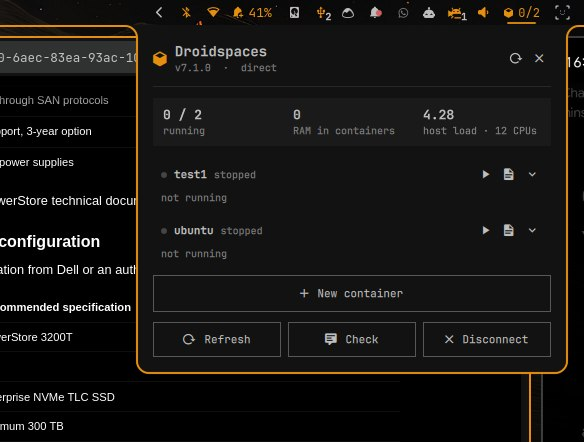
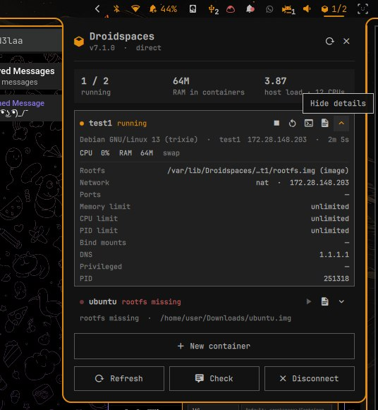
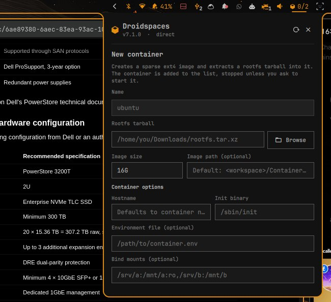
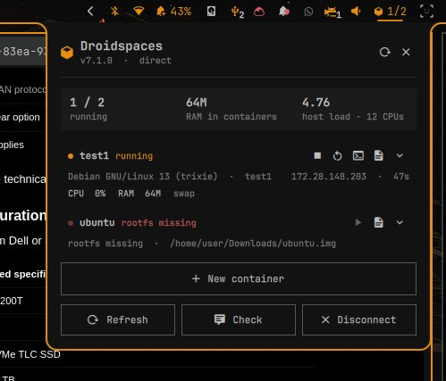

# Droidspaces for Omarchy

**Manage your [Droidspaces](https://github.com/ravindu644/Droidspaces-OSS/)
containers from the Omarchy bar** — live status, start/stop, a shell, and a
complete container creation form, without leaving the desktop.

[](#license)
[](#requirements)
[](https://quickshell.org/)

A [Quickshell](https://quickshell.org/) bar widget and panel for containers
managed by Droidspaces. The bar shows how many containers are running, and the
panel gives you the full picture: OS, hostname, IP, uptime, CPU and RAM, plus
one-click control over every container on the machine.

## Screenshots

| Bar widget and container list | Container details |
| :---: | :---: |
|  |  |

| New container form | Live container activity |
| :---: | :---: |
|  |  |

## Features

**At a glance**

- Live count on the bar (`running` or `running/total`)
- List of configured containers with OS, hostname, IP, uptime, CPU and RAM
- Warns when a container's rootfs image or directory is missing: the row says
  `rootfs missing`, Start is disabled, and the helper refuses to start it

**Container control**

- Start, stop and restart containers
- Open a shell in a running container
- Open a container's log
- Details for each container: rootfs, network mode, ports, memory/CPU/PID
  limits, bind mounts, DNS and privileged flags
- Refresh and `droidspaces check` from the panel

**Create from a rootfs tarball**

- Install a rootfs tarball (`.tar`, `.tar.xz`, `.tar.gz`, `.tar.zst`, …) into a
  sparse ext4 image
- Choose a name, tarball path (or **Browse**), image size (default `16G`) and
  an optional image path; by default the image goes to
  `<workspace>/Containers/<name>/rootfs.img`
- Creation formats the image, extracts the tarball, verifies `/sbin/init` or
  `/usr/sbin/init`, and writes the container config
- Optionally start the container as soon as it is created

**The useful CLI options, in the form**

The create form exposes the Droidspaces options without leaving the panel:
hostname and init binary, environment file, bind mounts, network mode (`nat`,
`host`, `none`, `gateway`, `macvlan`) with NAT/gateway/MACVLAN fields, DNS and
IPv6, memory/CPU/PID limits, privileged tags, and hardware or boot toggles such
as GPU, X11, swap, sandboxing and cgroups. Every option is validated by the
bridge before anything is formatted or mounted. Editing an existing container's
configuration still stays in the terminal.

**Keyboard friendly**

Everything in the panel can be driven from the keyboard:

| Key | Action |
| --- | --- |
| <kbd>↑</kbd> / <kbd>↓</kbd> | Move between containers |
| <kbd>Enter</kbd> / <kbd>Space</kbd> | Expand or collapse the selected container |
| <kbd>Tab</kbd> | Switch panels |
| <kbd>n</kbd> | New container |
| <kbd>s</kbd> | Start or stop the selected container |
| <kbd>r</kbd> | Refresh |
| <kbd>c</kbd> | Run `droidspaces check` |
| <kbd>d</kbd> | Disconnect the helper |
| <kbd>Esc</kbd> | Collapse or close the panel |

## Requirements

- [Omarchy](https://omarchy.org/) with its Quickshell-based shell
- [Droidspaces](https://github.com/ravindu644/Droidspaces-OSS/) installed at
  `/usr/bin/droidspaces`
- `pkexec` / polkit, used to start the root helper
- Python 3 (standard library only) for the helper
- For creating containers: `e2fsprogs` (`mkfs.ext4`/`mke2fs`), `tar` and
  `util-linux` (`mount`/`umount`), plus an ext4-capable kernel

## Install

Add the plugin from its repository and enable it:

```sh
omarchy plugin add https://github.com/abd3-13/omarchy-droidspaces.git --enable
```

Then enable the **Droidspaces** widget from the normal Omarchy plugin/bar
settings and place it in whichever bar section you prefer.

The first time the panel is opened, it asks for authentication to install and
start the root helper. On a new machine (or after a plugin update) this can
prompt twice: once to install the bridge and once to start it. Later sessions
ask once, on the first panel open, and every action after that is prompt-free
until you log out.

### Settings

Plugin settings live in `~/.config/omarchy/shell.json` and can be changed from
the Omarchy settings UI:

| Key | Default | Meaning |
| --- | --- | --- |
| `showCount` | `true` | Show the number next to the bar icon |
| `connectOnStartup` | `false` | Authenticate when the shell starts instead of on first open |

## How it works

Droidspaces needs root even to read live status (`show`, `check`) and for every
action (`start`, `stop`, `restart`). Prompting for every tick would be
unusable, so the widget starts one long-lived root bridge through `pkexec`:

1. `bin/ensure-helper` compares `bin/droidspaces-bridge` with the installed
   copy at `/usr/local/libexec/droidspaces-omarchy/bridge`.
2. If missing or different, it installs it with
   `/usr/bin/install -D -m 0755 -o root -g root` through `pkexec`. The root
   bridge is therefore root-owned, not a user-writable script.
3. It then `exec`s `pkexec /usr/local/libexec/droidspaces-omarchy/bridge --replace`.

The bridge streams one JSON object per line and accepts a small command set on
stdin (`refresh`, `watch`, `start`, `stop`, `restart`, `logs`, `check`,
`create`, `exit`). Creation streams `progress` messages while it prepares,
formats, mounts and extracts. Container names must match
`^[A-Za-z0-9][A-Za-z0-9._-]{0,63}$` and no shell is ever invoked. It ticks
every 6 s while closed and 2 s while the panel is open.

Two lifecycle rules keep exactly one helper alive: a newly started bridge stops
older copies of itself (`--replace`), and every bridge exits when the shell
process that started it disappears. Plugin reloads and shell restarts therefore
do not leave root helpers behind. **Disconnect** stops it immediately;
otherwise it stays connected until you log out.

## Files

```
local.droidspaces/
  manifest.json          plugin metadata and settings
  Panel.qml              bar widget + popup panel
  ContainerRow.qml       one container row and its details
  bin/droidspaces-bridge root helper (Python 3, installed by pkexec)
  bin/ensure-helper      install-if-needed + launch (called by the widget)
  bin/install-helper     install/refresh only (asks for authentication)
  bin/uninstall          remove the installed bridge
```

The bridge is standalone Python 3 with the standard library only. It can be
exercised without root against a fake workspace:

```sh
bin/droidspaces-bridge --workspace /tmp/ds-test --allow-nonroot --once
```

## Troubleshooting

- Shell logs: `journalctl --user -t omarchy-shell -f`
- Validate the manifest: `omarchy plugin validate <plugin-folder>`
- `pkexec` exit codes: `126` means the prompt was dismissed, `127` means the
  action was not authorized or the helper could not be started.
- The panel shows the last action error and the last `show` error. Use
  **Check** to run `droidspaces check` as root.
- If a plugin update changed the bridge, the next connect asks for
  authentication again to refresh the installed copy.
- After editing the QML, a full shell restart (`omarchy restart shell`) may be
  needed: hot reload can keep an older compiled component even when the file
  on disk has changed. The bridge is not affected by this.

## Security notes

- The helper is root-owned and only accepts the fixed command set above; it
  never passes a container name through a shell.
- Creation only runs the fixed tools `mkfs.ext4`/`mke2fs`, `mount`, `tar` and
  `umount` with validated paths; it refuses to overwrite an existing image or
  container config.
- Create options are validated first: network modes and MACVLAN modes must be
  known values, bind mount and environment paths must be absolute, and memory,
  CPU, PID and privileged settings are range-checked.
- It runs the system `/usr/bin/droidspaces` as root. Keep that binary and the
  container root filesystems trusted: a writable container rootfs is, by
  design, a way to run code as root inside that container.
- Starting the helper stops older copies of this bridge (matched by their
  exact root-owned path), so reloading the plugin cannot accumulate root
  processes.
- Opening a shell uses a new `pkexec` in a terminal, so it asks for
  authentication separately from the persistent helper.
- The helper exits when the shell exits; **Disconnect** stops it immediately.

## Uninstall

```sh
omarchy plugin disable local.droidspaces
~/.config/omarchy/plugins/local.droidspaces/bin/uninstall
```

The second command removes `/usr/local/libexec/droidspaces-omarchy/bridge`
after one authentication prompt. Adjust the path if you installed the plugin
into a different folder. Removing the plugin folder alone leaves the installed
helper behind.

To reinstall or refresh the helper manually (for example after editing
`bin/droidspaces-bridge`), run `bin/install-helper`; it asks for authentication
once and then returns.

## License

Released under the MIT License. See [LICENSE](LICENSE) for details.

Droidspaces itself is a separate project by
[ravindu644](https://github.com/ravindu644/Droidspaces-OSS/); this plugin is an
independent front end for it.
